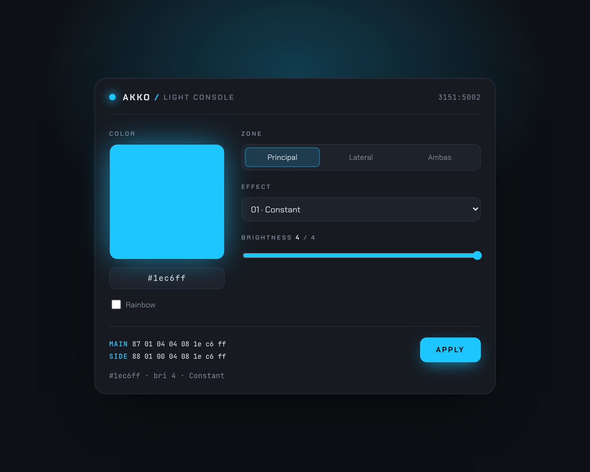

# Akko 5075 RGB

Open-protocol RGB control for the **Akko 5075** mechanical keyboard on Linux — a small
web console + CLI that speak the keyboard's vendor HID protocol directly, **without**
Akko's proprietary, Windows-only *Cloud Driver*.



> **The keyboard:** sold as the **Akko 5075** (the "B" / *Multi-modes* tri-mode wireless
> variant). The model printed on the **underside label is `K0055`**. USB id `3151:5002`
> (ODM: RongYuan / ROYUAN).

## Credits

**~95% of this protocol was already done** by the excellent
**[echtzeit-solutions/monsgeek-akko-linux](https://github.com/echtzeit-solutions/monsgeek-akko-linux)**
project — their [`docs/PROTOCOL.md`](https://github.com/echtzeit-solutions/monsgeek-akko-linux/blob/HEAD/docs/PROTOCOL.md)
is where the frame format, checksums, and command set come from. This repo stands on their
work (and the wider [SonixQMK](https://sonixqmk.github.io/SonixDocs/) community). All I did
was verify it on the **Akko 5075 / K0055** and map the model-specific differences:

- `options` low-nibble **inverted** vs the reference board (`0x08` = solid, `0x07` = dazzle)
- the hardware **palette indices** (`0x00`–`0x06` → the 7 Fn colors)
- **per-zone speed** direction (main inverted, side normal)
- the **side-bar** zone only supporting modes 0–5 (≥6 turns it off), and ripple needing dazzle there
- the two-zone behavior, Neon ignoring RGB, and the udev/no-sudo setup

**Status:** ✅ Read + write RGB working on both LED zones (keys + side bars): solid color,
hardware palette presets, dazzle/rainbow, brightness, speed, and the built-in effect
modes. Per-key addressing is the one piece still blocked (see §9).

**Quick start — WebHID (no server, recommended)**

```bash
sudo install -m 0644 60-akko-hidraw.rules /etc/udev/rules.d/60-akko-hidraw.rules
sudo udevadm control --reload-rules && sudo udevadm trigger --action=add --subsystem-match=hidraw
# then just open index.html in Chrome/Edge and click "Connect"
xdg-open index.html
```

The console runs **entirely in the browser** via [WebHID](https://developer.mozilla.org/docs/Web/API/WebHID_API) —
no Bun process, no `node-hid`, no HTTP backend. Chrome or Edge only (Firefox/Safari
don't ship WebHID). If `file://` doesn't grant a secure context on your setup, serve
the static file instead — still no keyboard access on the server side:

```bash
bun start            # static host -> http://localhost:3000 (no node-hid)
```

(The CLI helpers in §8 still use `node-hid`; run `bun install` for those.)

---

## TL;DR

| Question | Answer |
|---|---|
| Can it run **QMK**? | ❌ No. RongYuan/Beken firmware, no QMK port, incompatible MCU. |
| Is it supported by **OpenRGB**? | ❌ Not yet — open requests (issues [#3034](https://gitlab.com/CalcProgrammer1/OpenRGB/-/work_items/3034), [#2031](https://gitlab.com/CalcProgrammer1/OpenRGB/-/issues/2031)), protocol not merged. |
| Can we control RGB ourselves? | ✅ **Yes.** Same protocol as the RongYuan boards — read & write working. |

---

## 1. Hardware identification

```
$ lsusb
... ID 3151:5002 Akko Multi-modes Keyboard-B
```

- **Label model `K0055`** (underside sticker), marketed as the **Akko 5075** (B /
  Multi-modes). The USB descriptor calls it `Akko Multi-modes Keyboard-B`.
- **VID `0x3151`** belongs to **RongYuan / ROYUAN**, the ODM that writes the firmware
  for many Akko/MonsGeek keyboards — *not* to Beken or QMK. The VID is the strongest
  clue to which protocol the board speaks.
- Three USB HID interfaces. The report descriptors expose vendor usage pages but
  **none** of the QMK pages (`0xFF60` raw-HID / `0xFF31` console) — so it is **not**
  QMK firmware.

HID interfaces (from `node-hid` enumeration):

| iface | usage_page | usage | hidraw | role |
|---|---|---|---|---|
| 0 | 0x0001 | 0x0006 | hidraw6 | boot keyboard |
| 1 | 0x000c / 0x0001 | media / NKRO / etc | hidraw7 | multifunction |
| 1 | **0xFFFF** | 0x0001 | hidraw7 | vendor input |
| **2** | **0xFFFF** | **0x0002** | **hidraw8** | **vendor config ← we use this** |

Interface 2 (`usage_page 0xFFFF`, `usage 0x02`) matches exactly the *"Vendor Config"*
interface documented for RongYuan boards.

---

## 2. Why not QMK

QMK firmware is compiled per-board and flashed onto the MCU. It requires (a) a
QMK-supported MCU, (b) an existing port for the exact board, (c) a re-flashable
bootloader. Akko's "Multi-modes" line uses a proprietary RongYuan/Beken wireless
tri-mode chip with none of the above. Only some **wired** Akko boards with **Sonix
SN32F** MCUs can run community **[SonixQMK](https://sonixqmk.github.io/SonixDocs/)** —
this board is not one of them.

---

## 3. The protocol

The firmware speaks the protocol reverse-engineered by the
**[`echtzeit-solutions/monsgeek-akko-linux`](https://github.com/echtzeit-solutions/monsgeek-akko-linux)**
project (see its `docs/PROTOCOL.md`). That driver targets RongYuan **magnetic/HE**
boards, but because they share the same VID/ODM, the **framing is identical** — only
some command semantics differ (documented below).

### 3.1 Transport

- Interface **2**, usage page **0xFFFF**, **HID Feature Reports**.
- Report length **64 data bytes**; on Linux **report id `0` is prepended** → 65 bytes
  on the wire.
- Pattern: `SET_FEATURE` (command) → `GET_FEATURE` (response). Responses are buffered;
  read with a short delay and retry, correlating by the echoed command byte.

### 3.2 Frame format

```
[0]   CMD
[1-6] params
[7]   checksum         (Bit7 mode — most commands)
[8+]  payload
```

LED commands use **Bit8** checksum (one byte later, so all of bytes 1–7 are data):

```
[0]=CMD [1]=mode [2]=speed [3]=brightness [4]=options [5]=R [6]=G [7]=B [8]=checksum
```

### 3.3 Checksum

```
checksum = 255 - (sum(bytes[0..N]) & 255)
```

- **Bit7:** `N = 7`, stored at byte 7 (sum of bytes 0–6).
- **Bit8:** `N = 8`, stored at byte 8 (sum of bytes 0–7).

Examples (verified against the real keyboard):

```
GET_USB_VERSION:  8f 00 00 00 00 00 00 70           (0x8f → 255-0x8f = 0x70)
SET_LEDPARAM red: 07 01 00 04 08 ff 00 00 ec        (Bit8 → byte8 = 0xec)
```

---

## 4. Commands used

| Hex | Name | Dir | Notes |
|---|---|---|---|
| `0x8F` | GET_USB_VERSION | GET | `[0x8F, device_id[4], ?, ?, version[2]]` |
| `0x87` | GET_LEDPARAM | GET | current LED state (see §5) |
| `0x07` | SET_LEDPARAM | SET | **main keys** zone — set effect/color (**Bit8** checksum) |
| `0x87` (`0x08` set) | GET/SET_SLEDPARAM | both | **side bars** zone — same byte layout as `0x07`/`0x87` |
| `0x0C` | SET_USERPIC | SET | per-key static RGB (not used yet) |
| `0x80` | GET_REV | GET | returned zeros on this model (unimplemented) |

> ⚠️ The side-bar row above: **GET = `0x88`, SET = `0x08`** (Bit8 checksum), identical
> byte layout to the main zone.

Real captures from the keyboard:

```
>> 8f ...            << 8f c1 0a 00 00 06 00 08 01   (device_id c10a0000, ver 0801)
>> 87 ...            << 87 01 04 04 08 ff a2 00       (mode1, opt08, RGB ffa200 = orange)
```

---

## 5. LED parameters (`0x87` / `0x07`)

Byte layout of the LED params (after the cmd/echo byte):

| Byte | Field | Notes |
|---|---|---|
| 1 | **mode** | 0–25 effect (see table) |
| 2 | **speed** | inverted: `MAXSPEED(4) - actual` |
| 3 | **brightness** | 0–4 |
| 4 | **options** | color/direction flags — **see inversion below** |
| 5 | **R** | red |
| 6 | **G** | green |
| 7 | **B** | blue |

**Two zones.** The same byte layout drives two independent zones: the **main keys**
(`SET 0x07` / `GET 0x87`) and the **side light bars** (`SET 0x08` / `GET 0x88`).
Setting one does not affect the other. Solid color, dazzle, and brightness all work on
the side bars too (confirmed empirically — the reference HE board has no side bars, so
this isn't in the upstream doc). `mode=1` + `options=0x08` = solid; `options=0x07` =
dazzle, on both zones.

### 5.1 `options` low nibble = color source (differs from the doc)

The `options` low nibble selects WHERE the effect's color comes from. Mapped
empirically on this unit (the HE-board doc only mentions `7`/`8`, and with `7`↔`8`
swapped relative to here):

| low nibble | color source |
|---|---|
| `0x00`–`0x06` | **preset palette index** — the 7 colors the Fn shortcut cycles |
| `0x07` | **dazzle** — rainbow cycle (ignores R/G/B) |
| `0x08` | **custom RGB** — uses the R/G/B bytes (what our UI sends) |

Hardware Fn color shortcuts store a **palette index** (`0x00`–`0x06`) and ignore the
RGB bytes — which is why `GET` can report e.g. `#ffa200` while the keys show green.
**Only `0x08` actually uses the stored R/G/B.** The high nibble is direction/variant
for directional effects (Wave, etc.).

**Preset palette** (this unit — LEDs render warm, with weak green):

| idx | options | color |
|---|---|---|
| 0 | `0x00` | red |
| 1 | `0x01` | green |
| 2 | `0x02` | blue |
| 3 | `0x03` | orange (intended yellow; weak green → orange) |
| 4 | `0x04` | pink |
| 5 | `0x05` | yellow |
| 6 | `0x06` | white (renders light pink; LEDs can't do pure white) |

### 5.2 Effect modes (byte `mode`)

```
0 Off          7 Snake        14 Laser        21 Screen Sync
1 Constant     8 Reactive     15 Circle Wave  22 Music Bars
2 Breathing    9 Converge     16 Rainbow      23 Train
3 Neon        10 Sine Wave    17 Rain Down     24 Fireworks
4 Wave        11 Kaleidoscope 18 Meteor        25 Per-Key Color
5 Ripple      12 Line Wave    19 Reactive Off
6 Raindrop    13 User Picture 20 Music Patterns
```

### 5.3 Effect quirks (observed on this unit)

- **Speed byte direction differs per zone:** main zone is **inverted** (byte `4` = slowest,
  `0` = fastest); side bars are **normal** (`4` = fastest). The web UI normalizes both so the
  slider always means "right = faster".
- **Side bars only support modes 0–5** (Off, Constant, Breathing, Neon, Wave, Ripple). Modes
  ≥ 6 **turn the side bars OFF (dark)**. The UI shows only 0–5 when the **side** zone is
  selected; for **Ambas** the full list is shown, but the backend applies modes ≥6 to the
  **main zone only** and skips the side (left untouched).
- **Neon (3) ignores R/G/B** on both zones (uses its own colors).
- **Ripple (5) on the side bars** only animates continuously with **dazzle on**; with a solid
  color it animates once on set then freezes. The UI handles this: it blocks the color picker
  for side+ripple, and the backend **forces dazzle (`0x07`)** for that case (without touching
  the dazzle checkbox).

---

## 6. Color notes

- **OpenRGB hex is BGR-ordered.** OpenRGB stores color internally as `0x00BBGGRR` and
  its hex field prints that integer raw. So OpenRGB's `0037FF` = `B=00 G=37 R=FF` =
  web `#FF3700`. **A future OpenRGB port must swap R↔B** before building the packet.
- **LED rendering:** keyboard LEDs render low green poorly. `#FF3700` (G=55) looks red;
  `#FF7300` (G=115) looks orange; `#FFA200` (G=162) is amber. For vivid orange keep
  `G ≳ 115`. This is the LEDs/gamma, not a protocol bug — the green channel works
  (the keyboard's original orange was `ffa200`).

---

## 7. Access without sudo (udev)

The `/dev/hidraw*` nodes are root-only by default. Rule
[`60-akko-hidraw.rules`](./60-akko-hidraw.rules) grants the active local user access
via `uaccess`:

```
SUBSYSTEM=="hidraw", ATTRS{idVendor}=="3151", ATTRS{idProduct}=="5002", TAG+="uaccess", MODE="0660"
```

> ⚠️ **The filename number matters.** systemd applies `uaccess` from
> `73-seat-late.rules`, so the tag must be set by a rule that runs *before* it — i.e.
> numbered **< 73** (here `60-`, like `60-openrgb.rules`). A `99-` rule sets the tag
> *after* the builtin already ran, so the ACL is never applied and you still need
> `sudo`. (Check the db with `udevadm info /dev/hidraw8 | grep TAGS` — the tag can be
> present yet have had no effect.)

Install:

```bash
sudo install -m 0644 60-akko-hidraw.rules /etc/udev/rules.d/60-akko-hidraw.rules
sudo rm -f /etc/udev/rules.d/99-akko-hidraw.rules   # remove the old too-late rule, if installed
sudo udevadm control --reload-rules
sudo udevadm trigger --action=add --subsystem-match=hidraw   # --action=add is required;
                                                             # 'change' won't re-apply uaccess
getfacl -p /dev/hidraw8 | grep '^user'   # expect: user:<you>:rw-
```

`uaccess` needs a **local** (non-SSH) active logind session on the seat. If on SSH,
use a group rule (`GROUP="input", MODE="0660"`) + `usermod -aG input <you>` instead.

---

## 8. Scripts

Bun + `node-hid` (TypeScript). `bun add node-hid` once.

**Web UI (WebHID, main tool) — `index.html`:**
```text
Open index.html in Chrome/Edge and click "Connect" (or `bun start`).
Talks to the keyboard directly from the browser — no backend, no node-hid.
Controls: color picker + hex, brightness, speed, dazzle toggle, effect dropdown,
zone selector (Main / Side / Both). Reads both zones live on connect;
a previously-granted device auto-reconnects on reload.
```

WebHID uses the same Feature-Report transport as the CLI: `sendFeatureReport(0, …)`
(SET_FEATURE) and `receiveFeatureReport(0)` (GET_FEATURE) on the vendor config
collection (`usagePage 0xFFFF`, `usage 0x02`). Still needs the udev rule in §7.

**CLI helpers:**
```bash
bun probe.ts              # read-only protocol probe + verdict
bun setled.ts 0 255 0     # main solid color (R G B); 'restore' re-sends current
bun sled.ts 1 08 4 00ff00 # side bars: <mode> <optionsHex> <bri> <rrggbb>
bun palidx.ts 3           # main palette index (options low nibble 0-6)
bun userpic.ts ff0000     # per-key experiment (0x0C — currently a no-op, see §9)
```

**Rust CLI (`cli/`, Linux x86_64):**
```bash
mise use -g github:roziscoding/akko-5075-rgb

akko-rgb status                        # current lighting of each zone
akko-rgb effects                       # list effects
akko-rgb color ff3700                  # solid color on both zones
akko-rgb color '#ff3700' --zone side   # one zone: all, keys or side
akko-rgb set -e wave -s 3 -b 2 -c 00ff00
akko-rgb set -e breathing --rainbow
akko-rgb off
```

Only the settings you pass change. Needs the udev rule in §7. Releases are cut from
Conventional Commits on `main`.

---

## 9. Status / Next steps

- [x] **Effect modes** — `mode` byte 0–25 (wave, breathing, reactive, rainbow…),
      with a speed byte. Exposed in the web UI dropdown + speed slider.
- [ ] **Per-key RGB — BLOCKED on stock firmware.** `SET_USERPIC` (`0x0C`) is silently
      ignored: every guessed frame is a no-op (the keyboard doesn't even flicker). mode 13
      *displays* a stored picture (a factory gaming preset — WASD white, ESC red) but we
      can't write the buffer. The clean streaming command `0xE8` (LED_STREAM, 18 keys/page)
      is **patch-firmware only**. Cracking this needs a **USB capture of the Akko Cloud
      Driver** (Windows / USBPcap or a Windows VM) to get the exact `0x0C` wire format,
      then replay it.
- [ ] A proper CLI (`akko-rgb set FF7300`, `effect wave`, `brightness 3`).
- [ ] Port the protocol to **OpenRGB** (C++) — remember the BGR swap and the inverted
      options nibble.

---

## References

- monsgeek-akko-linux protocol spec: <https://github.com/echtzeit-solutions/monsgeek-akko-linux/blob/HEAD/docs/PROTOCOL.md>
- SonixQMK (for the *wired* Sonix-based Akko boards): <https://sonixqmk.github.io/SonixDocs/>
- OpenRGB device requests: [#3034](https://gitlab.com/CalcProgrammer1/OpenRGB/-/work_items/3034), [#2031](https://gitlab.com/CalcProgrammer1/OpenRGB/-/issues/2031)
